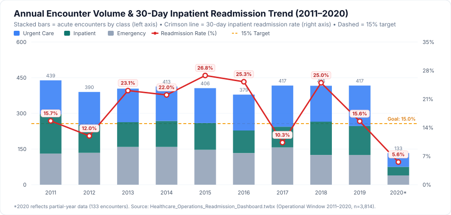
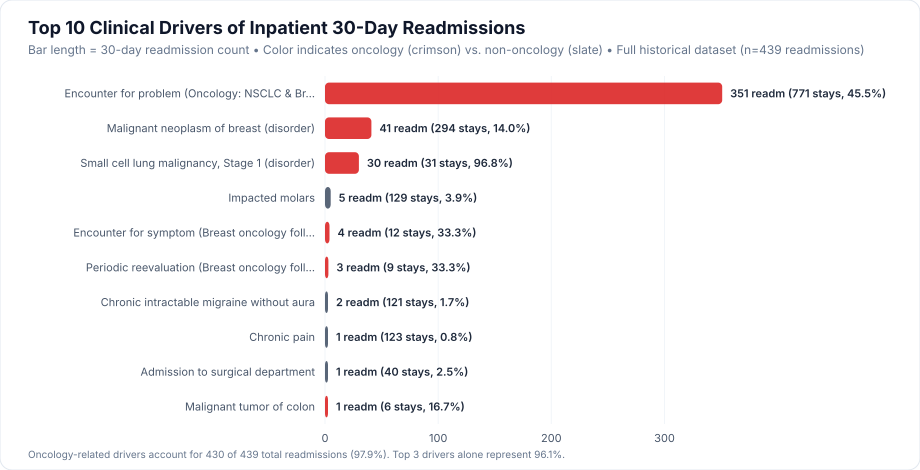
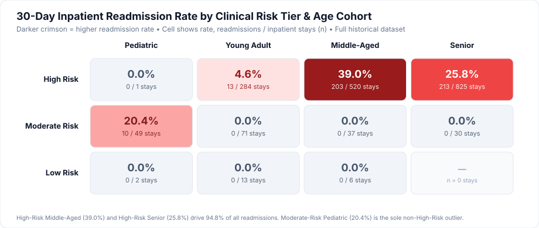
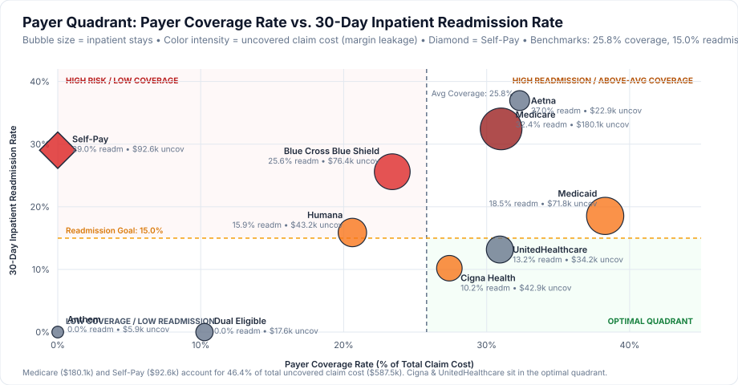

# Healthcare Operations & 30-Day Readmission Executive Report

> **Source Workbook:** `Healthcare_Operations_V2.twbx` (`Healthcare Operations & Readmission V1`)  
> **Scope:** 6,301 acute encounters across 941 unique Massachusetts patients (Full Historical Scope: 1923–2020; Operational Window: 2011–2020, n = 3,814)  
> **Live Interactive Dashboard:** [View on GitHub Pages](https://ahmedelsayed7115.github.io/healthcare-operations-report/)

---

## Executive Summary

An end-to-end operational, clinical, and financial audit of **6,301 acute care encounters** (2,373 urgent care, 2,090 emergency, 1,838 inpatient) reveals a highly concentrated clinical readmission crisis paired with systemic revenue cycle leakage:

1. **Readmissions Exceed Target by +8.9 Percentage Points:** The overall 30-day inpatient readmission rate is **23.88%** (439 / 1,838 stays) against the **15.0% target** (**19.03%** during the 2011–2020 operational window, exceeding target in 7 of 10 years).
2. **Oncology Accounts for 97.9% of All Readmissions:** Six oncology-related clinical drivers generate **430 of 439 readmissions**. A single category—*Encounter for problem (Oncology: NSCLC & Breast)*—drives **80.0% (351/439)** of all readmissions at a **45.5%** rate, while *Small cell lung malignancy (Stage 1)* exhibits a **96.8%** readmission rate (30/31 stays).
3. **Extreme Concentration in High-Risk Adults:** High-risk patients generate **97.72% (429/439)** of all readmissions, with **High-Risk Middle-Aged (39.0% rate, 203 readmissions)** and **High-Risk Senior (25.8% rate, 213 readmissions)** accounting for **94.8%** of total volume. The sole non-high-risk signal is **Moderate-Risk Pediatric (20.4% rate, 10/49 stays)**.
4. **74.2% of Claim Costs Go Uncovered ($587.5k Margin Leakage):** Across **$791,981** in total claim costs, payers cover only **25.81% ($204,435)**, leaving **$587,546** uncovered. **Medicare ($180.1k)** and **Self-Pay / Uncompensated Care ($92.6k)** alone drive **46.4%** of total margin leakage.
5. **Length of Stay Is Healthy Once 5 Data Outliers Are Removed:** Raw inpatient average LOS appears alarming at **18.04 days**, but this is distorted by just **5 extreme outlier records** (74 to 20,215 days, mostly unclosed breast oncology follow-ups). Excluding outliers yields a **1.00 Clean O/E LOS Ratio** (**1.09 days** clean average LOS; **0.97 O/E** in 2011–2020).

---

## Executive KPI Scorecard

| KPI | Full Historical Scope (n = 6,301) | Operational Window 2011–2020 (n = 3,814) | Target / Benchmark | Status |
| :--- | :---: | :---: | :---: | :---: |
| **30-Day Inpatient Readmission Rate** | **23.88%** (439 / 1,838) | **19.03%** (207 / 1,088) | ≤ 15.0% | 🔴 Above Target |
| **Clean O/E Length of Stay Ratio** | **1.00** (1.09d clean vs. 18.04d raw) | **0.97** (1.05d clean vs. 1.11d raw) | ≤ 1.00 | 🟢 On Target |
| **Uncovered Claim Cost (Margin Leakage)** | **$587,546** (74.19% uncovered) | **$358,483** (74.20% uncovered) | Minimize | 🔴 Critical |
| **Payer Coverage Rate** | **25.81%** ($204,435 / $791,981) | **25.80%** ($124,626 / $483,109) | ≥ 25.8% avg | 🟡 At Benchmark |
| **High-Risk Share of Readmissions** | **97.72%** (429 / 439) | **96.62%** (200 / 207) | Monitor | 🔴 Highly Concentrated |

---

## 1. Annual Volume & 30-Day Readmission Trend (2011–2020)



### Key Findings
- **Stable Core Demand with Urgent Care Shift:** From 2011 through 2019, total acute encounters held steady between **379 and 439 per year** (averaging 409/year). Urgent care volume rose from **142 (2011)** to **170–173 (2017, 2019)**, becoming the largest acute care channel. *(2020 reflects partial-year capture with 133 encounters.)*
- **Chronic Goal Misses:** Inpatient readmission rates breached the **15.0% goal in 7 of 10 years**, peaking at **26.8% (2015)**, **25.3% (2016)**, and **25.0% (2018)**.
- **Volatility Driven by Oncology Cohort Cycles:** Sharp single-year drops in **2012 (12.0%)** and **2017 (10.3%)** followed by immediate rebounds above 23–25% reflect episodic oncology inpatient clusters rather than sustained process improvements.

| Year | Emergency | Inpatient | Urgent Care | Total Encounters | 30-Day Readmissions | Readmission Rate |
| :---: | :---: | :---: | :---: | :---: | :---: | :---: |
| 2011 | 131 | 166 | 142 | 439 | 26 | 15.7% |
| 2012 | 134 | 117 | 139 | 390 | 14 | 12.0% |
| 2013 | 159 | 104 | 141 | 404 | 24 | 23.1% |
| 2014 | 159 | 109 | 145 | 413 | 24 | 22.0% |
| 2015 | 147 | 112 | 147 | 406 | 30 | **26.8%** |
| 2016 | 133 | 95 | 151 | 379 | 24 | 25.3% |
| 2017 | 157 | 87 | 173 | 417 | 9 | 10.3% |
| 2018 | 125 | 140 | 151 | 416 | 35 | 25.0% |
| 2019 | 125 | 122 | 170 | 417 | 19 | 15.6% |
| 2020* | 39 | 36 | 58 | 133 | 2 | 5.6% |

*\*Partial-year capture in 2020.*

---

## 2. Top 10 Clinical Drivers of Inpatient Readmissions



### Key Findings
- **Pareto Concentration:** The **Top 3 clinical drivers generate 422 of 439 readmissions (96.1%)**, and all 6 oncology-related drivers in the Top 10 account for **430 of 439 readmissions (97.9%)**.
- **Highest Volume Driver:** *Encounter for problem (Oncology: NSCLC & Breast)* alone generates **351 readmissions** across 771 inpatient stays (**45.5%** rate) and **$56,812** in margin leakage.
- **Highest Intensity Driver:** *Small cell lung malignancy, Stage 1* has a **96.8% readmission rate** (30 readmissions out of 31 inpatient stays), signaling cyclical inpatient chemotherapy/readmission workflows that could be evaluated for outpatient infusion or structured transitional care pathways.
- **Non-Oncology Stays Are Low-Readmission:** High-volume non-oncology inpatient drivers (*Impacted molars* at 3.9%, *Chronic intractable migraine* at 1.7%, *Chronic pain* at 0.8%) perform well below the 15% benchmark.

| Rank | Primary Clinical Driver | Inpatient Stays | 30-Day Readmissions | Readmission Rate | Margin Leakage |
| :---: | :--- | :---: | :---: | :---: | :---: |
| 1 | Encounter for problem (Oncology: NSCLC & Breast) | 771 | **351** | **45.5%** | $56,812 |
| 2 | Malignant neoplasm of breast (disorder) | 294 | **41** | 14.0% | $17,904 |
| 3 | Small cell lung malignancy, Stage 1 (disorder) | 31 | **30** | **96.8%** | $1,240 |
| 4 | Impacted molars | 129 | 5 | 3.9% | $9,039 |
| 5 | Encounter for symptom (Breast oncology follow-up) | 12 | 4 | 33.3% | $1,437 |
| 6 | Periodic reevaluation (Breast oncology follow-up) | 9 | 3 | 33.3% | $1,098 |
| 7 | Chronic intractable migraine without aura | 121 | 2 | 1.7% | $8,464 |
| 8 | Chronic pain | 123 | 1 | 0.8% | $8,527 |
| 9 | Admission to surgical department | 40 | 1 | 2.5% | $2,936 |
| 10 | Malignant tumor of colon | 6 | 1 | 16.7% | $370 |

---

## 3. Patient Risk Stratification: Risk Tier × Age Cohort Heatmap



### Key Findings
- **Two Priority Cohorts Drive 94.8% of Readmissions:**
  - **High-Risk × Middle-Aged:** **39.0%** readmission rate (**203** readmissions / 520 stays) — the single highest-rate major cohort.
  - **High-Risk × Senior:** **25.8%** readmission rate (**213** readmissions / 825 stays) — the highest absolute volume cohort.
- **Hidden Pediatric Signal:** **Moderate-Risk × Pediatric** records a **20.4% readmission rate** (10 / 49 stays), representing **100% of all non-High-Risk readmissions** in the dataset.
- **Zero Readmissions in Low Risk:** Across all age cohorts, **Low-Risk** patients recorded **0 readmissions** (21 inpatient stays), confirming that care-management resources should be aggressively concentrated on High-Risk adults and targeted Moderate-Risk pediatric discharges.

---

## 4. Payer Mix & Financial Exposure Quadrant



### Key Findings
- **Top 2 Financial Exposures (46.4% of All Margin Leakage):**
  - **Medicare:** **$180,115** uncovered cost (30.7% of total), **32.4% readmission rate** (144/444 stays), 31.0% coverage rate. High readmission rates expose the organization to CMS Hospital Readmissions Reduction Program (HRRP) penalties.
  - **Self-Pay / Uncompensated Care:** **$92,581** uncovered cost (15.8% of total), **0.0% coverage**, **29.0% readmission rate** (90/310 stays).
- **Worst Commercial Quadrant:** **Blue Cross Blue Shield** combines below-benchmark coverage (**23.4%**) with an elevated **25.6% readmission rate**, producing **$76,419** in uncovered cost.
- **High-Readmission Outlier:** **Aetna** exhibits the highest readmission rate of any payer (**37.0%**, 17/46 stays) despite above-average coverage (32.3%).
- **Optimal Quadrant Performers:** **Cigna Health** (27.4% coverage, 10.2% readmissions) and **UnitedHealthcare** (30.9% coverage, 13.2% readmissions) both exceed the coverage benchmark while staying under the 15% readmission target.

| Payer | Group | Encounters | Inpatient Stays | Readmissions | Readmission Rate | Coverage Rate | Margin Leakage |
| :--- | :--- | :---: | :---: | :---: | :---: | :---: | :---: |
| **Medicare** | Insured | 2,022 | 444 | 144 | **32.4%** | 31.0% | **$180,115** |
| **Self-Pay / Uncompensated** | Self-Pay | 746 | 310 | 90 | **29.0%** | **0.0%** | **$92,581** |
| **Blue Cross Blue Shield** | Insured | 790 | 293 | 75 | 25.6% | 23.4% | $76,419 |
| **Medicaid** | Insured | 955 | 329 | 61 | 18.5% | **38.3%** | $71,754 |
| **Humana** | Insured | 457 | 151 | 24 | 15.9% | 20.6% | $43,167 |
| **Cigna Health** | Insured | 463 | 108 | 11 | **10.2%** | 27.4% | $42,857 |
| **UnitedHealthcare** | Insured | 403 | 129 | 17 | **13.2%** | 30.9% | $34,244 |
| **Aetna** | Insured | 266 | 46 | 17 | **37.0%** | 32.3% | $22,872 |
| **Dual Eligible** | Insured | 153 | 26 | 0 | 0.0% | 10.3% | $17,594 |
| **Anthem** | Insured | 46 | 2 | 0 | 0.0% | 0.0% | $5,941 |

---

## 5. Service Line & Data Quality Diagnostics

### Service Line Performance
| Clinical Service Line | Encounters | Inpatient Stays | Readmissions | Readmission Rate | Total Claim Cost | Margin Leakage |
| :--- | :---: | :---: | :---: | :---: | :---: | :---: |
| **General Medicine** | 5,606 | 1,710 | 409 | 23.9% | $702,215 | $538,148 |
| **Obstetrics** | 300 | 1 | 0 | 0.0% | $38,748 | $19,795 |
| **Cardiology** | 256 | 59 | 0 | 0.0% | $33,065 | $19,670 |
| **Pulmonology** | 112 | 42 | 30 | **71.4%** | $14,466 | $7,937 |
| **Orthopedics** | 27 | 26 | 0 | 0.0% | $3,487 | $1,997 |

### Length of Stay (LOS) Outlier Audit
- **5 outlier encounters** (`is_los_outlier = 1`) span **74.2 to 20,215.2 days (~55.4 years)** — 4 breast oncology follow-ups and 1 appendicitis encounter.
- These 5 records inflate raw inpatient average LOS by **16.5×** (from **1.09 days** clean to **18.04 days** raw). Implementing automated EHR discharge-closure checks will prevent open-encounter timestamps from distorting executive LOS reporting.

---

## 6. Strategic Recommendations

| Priority | Initiative | Target Segment | Expected Impact |
| :---: | :--- | :--- | :--- |
| **P1 — Clinical** | **Oncology Transitional Care & Outpatient Infusion Navigation** | NSCLC, Breast & Stage 1 SCLC patients (430 readmissions) | Deploying 72-hour post-discharge nurse navigation and shifting planned oncology encounters to outpatient infusion can cut total readmissions by **40–60%**, bringing the system below the **15% goal**. |
| **P1 — Financial** | **Self-Pay Medicaid Presumptive Eligibility & Financial Navigation** | Self-Pay / Uncompensated Care ($92.6k leakage, 29.0% readm) | Screening uninsured patients at admission for Medicaid/charity eligibility (Medicaid covers 38.3% vs. 0% self-pay) can recover **$30k–$35k+** in annual margin leakage while improving post-discharge medication adherence. |
| **P2 — Payer** | **Medicare HRRP Protection & BCBS Contract Renegotiation** | Medicare ($180.1k leakage, 32.4% readm) & BCBS ($76.4k, 23.4% cov) | Pair high-risk senior care management with BCBS fee-schedule/denial audits to lift commercial coverage above the 25.8% benchmark. |
| **P2 — Clinical** | **Targeted Moderate-Risk Pediatric Discharge Audit** | Moderate-Risk Pediatric cohort (20.4% readm, 10/49 stays) | Audit the 10 pediatric readmissions to close care gaps in the only non-High-Risk segment experiencing readmissions. |
| **P3 — Data Ops** | **Automated EHR Encounter-Closure Validation** | 5 LOS outliers (74–20,215 days) | Add automated 30-day open-encounter alerts in EHR/ETL pipelines so raw and clean O/E LOS remain aligned. |

---

## Methodology & Repository Structure

All metrics are computed directly from the packaged workbook's underlying tables (`fact_encounters_v1.csv`, 6,301 rows; `dim_patients_v1.csv`, 1,171 rows) using exact Tableau calculated field formulas:
- **Inpatient Readmission Rate:** `SUM(is_30d_readmission) / SUM(is_inpatient)`
- **Clean O/E LOS Ratio:** `SUM(actual_los_days WHERE is_los_outlier=0) / SUM(expected_los_days_clean WHERE is_los_outlier=0)`
- **Payer Coverage Rate:** `SUM(payer_coverage) / SUM(total_claim_cost)`
- **Uncovered Claim Share:** `SUM(margin_leakage) / SUM(total_claim_cost)`
- **High-Risk Share of Readmissions:** `SUM(is_30d_readmission WHERE clinical_risk_tier='High Risk') / SUM(is_30d_readmission)`

```text
healthcare-operations-report/
├── README.md                          # Full Executive Report (this document)
├── index.html                         # Interactive Web Dashboard (GitHub Pages)
├── assets/
│   ├── view1_annual_trend.svg         # Annual Volume & Readmission Trend (2011–2020)
│   ├── view2_clinical_drivers.svg     # Top 10 Clinical Drivers of Readmissions
│   ├── view3_risk_heatmap.svg         # Risk Tier × Age Cohort Heatmap
│   └── view4_payer_quadrant.svg       # Payer Coverage vs. Readmission Quadrant
├── data/
│   └── analysis_summary.json          # Exact computed metrics for full & 2011–2020 scopes
└── scripts/
    └── generate_report_assets.py      # Reproducible SVG & metrics generator
```
